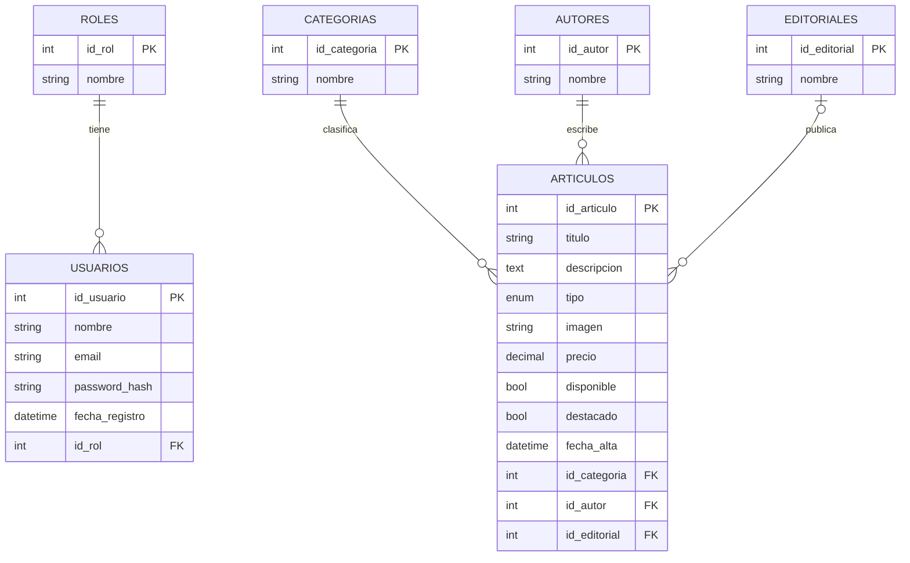

# Modelo Entidad-Relación (MER) — Biblioteca Virtual

## Cardinalidades
- Un **rol** tiene muchos **usuarios**; un usuario tiene exactamente un rol (1:N).
- Una **categoría** clasifica muchos **artículos**; un artículo pertenece a una categoría (1:N).
- Un **autor** escribe muchos **artículos**; un artículo tiene un autor (1:N).
- Una **editorial** publica muchos **artículos**; un artículo puede no tener editorial (0..1 : N).

> Para entregar: dibujá este MER en draw.io / MySQL Workbench / Lucidchart (notación a elección de la cátedra) y subí la imagen a /docs. Podés ver este diagrama pegando el bloque en https://mermaid.live
